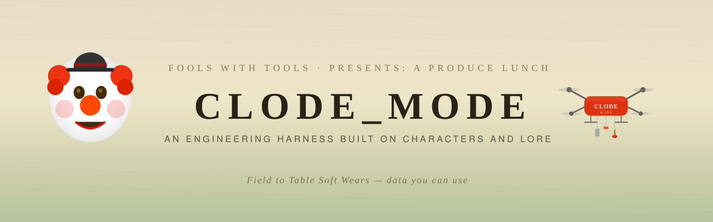

  

## What this is

> **CLODE and I build better apps for you. Logic Layer: Spreadsheets to Software.**
> Kris Thompson, [Austin Voice Data LLC](https://austinvoicedata.com)

CLODE is short for **CLODE_MODE, an engineering harness**. It is how Kris builds
your app. AI coding agents do the building, under rules he sets and checks they
must pass. The harness is a Django and MCP control plane that the agents work
*through* rather than around. The repositories in this organization are the
harness, its knowledge, and the apps it has built.

**Characters are addresses, not decoration.** Every capability in the platform belongs to
a named character, and that name is how you reach it. `krispy` packages and ships.
`porter` reconciles. `clogger` watches logs. `cinders` does SVG craft. Asking "who owns
this?" has a literal answer you can query, so an agent never has to guess where a
capability lives. It looks up the character.

## TRUTH and LORES

| **TRUTH** | **LORES** |
|---|---|
| What has been checked, written down. | What we have learned, written down. |
| A test that ran, a result that was measured. A claim about your app rests on TRUTH, not on memory. | Rules, specifications and lessons. An agent reads the LORE for its task before it changes anything. |
| Used **after** the work. | Used **before** the work. |
| Kept as `truth` rows, in each app's test suite, and at the push gate that refuses a failing push. | Kept as structured entries: decisions, naming rules, specs, and the reasoning behind them, not scattered through comments and commit messages. Every entry can carry a `dont` (the failure it prevents) and a way to verify it. Hard-won knowledge survives the end of a session instead of being rediscovered by the next one. |

TRUTH leads: a claim is only as good as the check behind it. The LORES are how the
work gets there. The platform keeps its TRUTH and LORES in one repository, and each
app keeps its own.

## By the numbers

Measured against the running platform on 2026-11-21, not aspirational:

| | |
|---|---|
| LORE entries | **10,427**, **5,112** of them active, across 14 app scopes |
| &nbsp;&nbsp;of which `truth` rows | 1,376 |
| &nbsp;&nbsp;by status: canonical / shipped / design / building | 2,881 / 4,195 / 2,077 / 154 |
| Characters registered | **50 active** (55 total) |
| MCP tools | **768**, in 380 toolboxes, owned by 33 characters |

## How work happens

Work dispatches as a **CODI** — a Context-Oriented Delivery Initiative. A CODI is an agent
that has been handed the contract before it starts: the relevant LORE, the tools its
character owns, and a shared bus so parallel threads can see each other instead of
silently colliding. When it finishes, it records what it consulted, which is how the
knowledge base learns whether its own entries are actually being used.

Three invariants hold across the whole platform:

1. **A shared bus for cross-agent state** — parallel work is visible, not blind.
2. **All writes go through management commands** — no ad-hoc mutation of live data.
3. **Characters are skillset addresses, resolved from the database** — never hardcoded.

## Shipped

### [EagleLakeRocks](https://github.com/clodemode/EagleLakeRocks) · [rocks.opeongo.net](https://rocks.opeongo.net)

A public map of marked boat hazards on Eagle Lake, Ontario, built for the Eagle Lake
Property Owners Association, plus an openly licensed dataset.

It is also the clearest statement of how stacks get chosen here. The rest of the fleet is
Django. This is not — 18 hazards and no background jobs did not need an ORM, and the app
has to survive years unattended, so it is a Go static binary on `scratch` with **two**
direct dependencies and no shell or package manager in the image. Roughly 5 MB, 256 MB of
RAM, suspended when idle; warm requests come back in about 0.2 s.

The data is the interesting part: the original production database existed in no git
repository, and the coordinates were recovered from a browser console log and two
screenshots before shell access to the retired VM turned up and superseded the estimate.
Every point in the open dataset carries its own `source`, and unconfirmed volunteer
reports are flagged as candidates rather than quietly mixed in with the surveyed ones —
these mark boat hazards, so the dataset declines to make a claim it cannot back.

Open data: [`rocks.geojson`](https://rocks.opeongo.net/api/eaglelake/rocks.geojson) ·
CC BY 4.0 · CORS-open · code MIT.

### [RoadTrip](https://github.com/clodemode/RoadTrip) · [roadtrip.opeongo.net](https://roadtrip.opeongo.net)

A live web page for one road trip. You plan the days, then post from your phone as the
miles go by: check-ins, photos and notes land on a map your friends and family can follow.
It is one small Go program with a SQLite file beside it, so it runs on the cheapest
virtual machine you can rent.

Home and hosts' homes are published as a roughly one-kilometre square, never the point,
and photos have their GPS and camera details stripped before they are stored. There is a
planner for days, miles and driving hours, and a large-type driver screen for a dash
mount. When the trip ends, the site stays up as a record of it.

### [PingTrail](https://github.com/clodemode/PingTrail)

*Our internet feels slow — which segment is injecting the latency?* Every ping tool
reports the round trip to one place. PingTrail fires ICMP at **every rung of a ladder at
once** — loopback, your router, the second router inside the house, the first public
ISP device, the resolver, the open internet, a distant anchor — and subtracts. Because
every rung sees the same instant, the difference between adjacent rungs is attributable
to the segment between them; stack the segments and the band that swells is the answer.

It is the counterweight to the entry above. Here the framework is the right call: there
is real request/response, templating and charting to do, so it is Django + HTMX +
ECharts on the same harness as the rest of the fleet. Two links make the stack-choice
claim demonstrable; one would make it an anecdote.

The measurement discipline is the part worth reading: stacked bars, never lines, because
a line invents latency between samples; negative deltas are kept, because a router that
answers its own ICMP on a slow path while forwarding on the fast path is a real signal;
and a rung at full loss whose downstream neighbour still answers is the tool's strongest
finding, not a failure. The web app never pings — a host-side vantage owns the ICMP,
since inside a container the default gateway is the bridge. Code MIT.

### In preparation

**FinTrack** — double-entry accounting: statement reconciliation, bill scheduling, and
tax preparation, in production against real books. **MusicOrgan** — a browse-and-play web
UI over a large music library with cover-art and metadata enrichment. Both run on the
harness today; both are being prepared for public release rather than announced early.

## More

The characters have a home of their own at **[clodemode.com](https://clodemode.com)**.

---

  &copy; 2026 Austin Voice Data LLC &middot; <a href="https://clodemode.com">clodemode.com</a>

